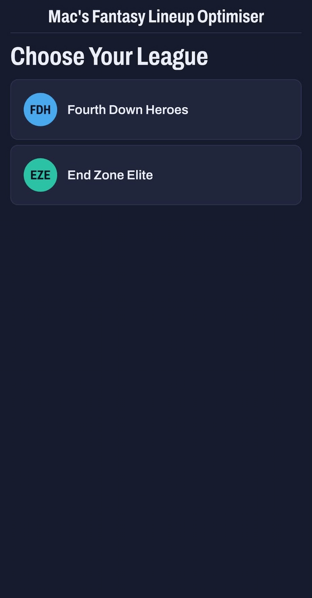
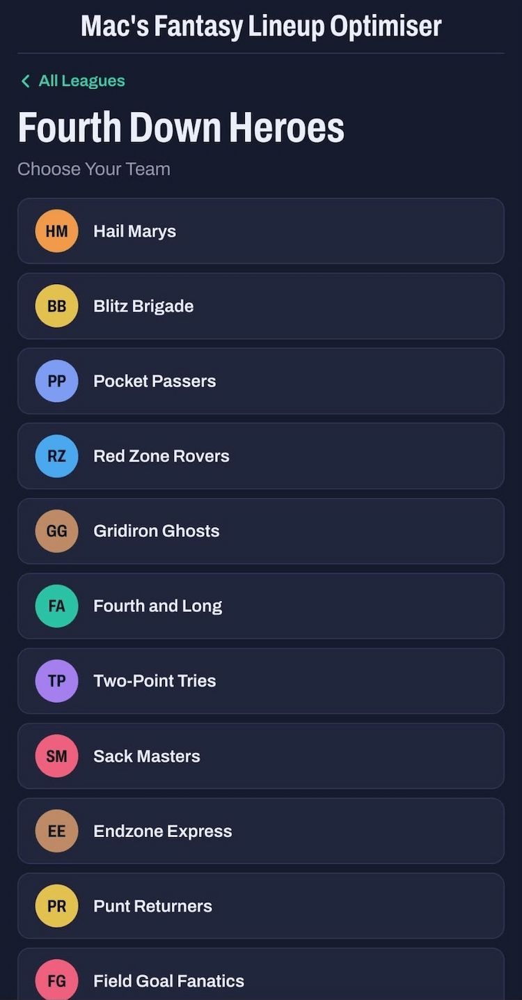
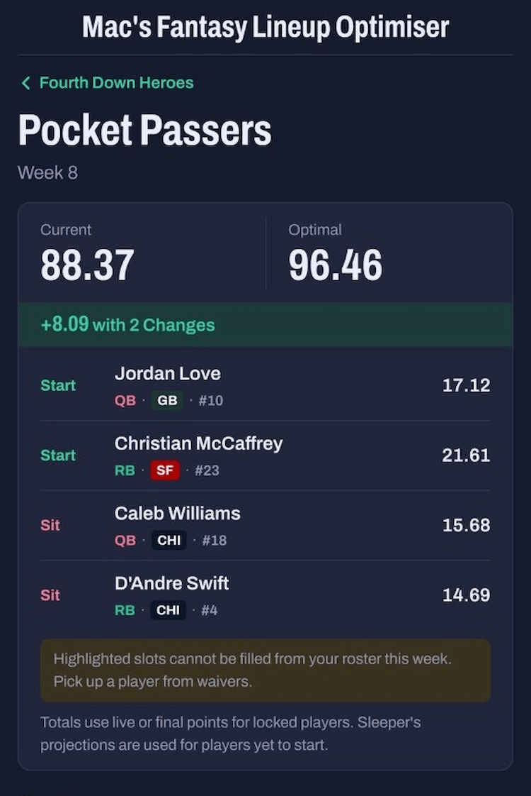
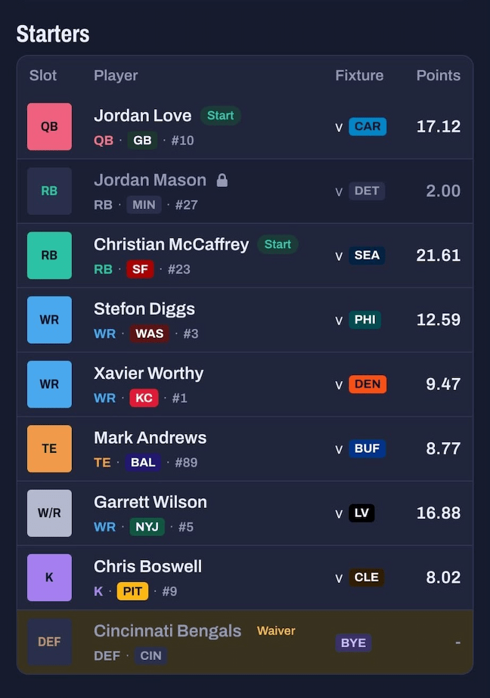
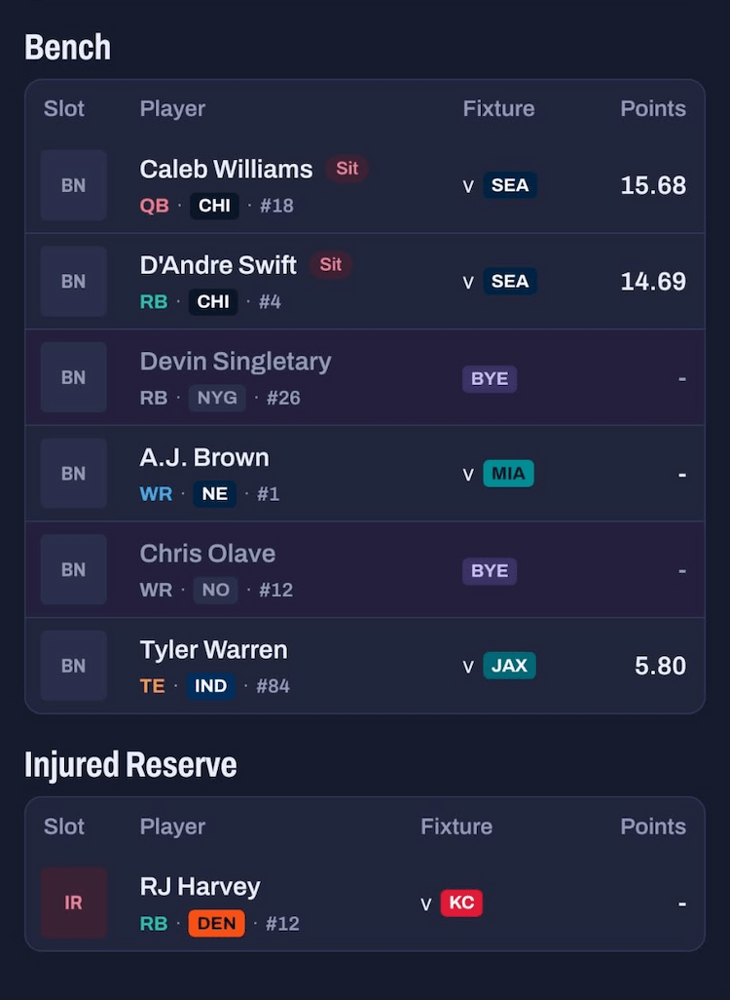
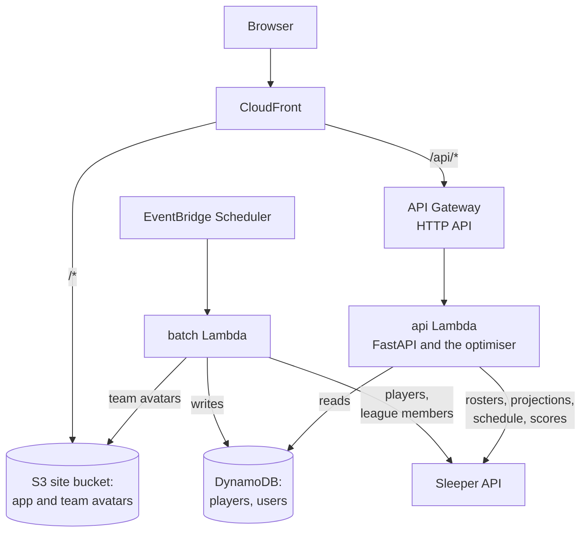

# Fantasy Lineup Optimiser

[](https://github.com/JamesMcNeill2/fantasy-optimiser/actions/workflows/deploy.yml)

A web app that shows fantasy football managers on [Sleeper](https://sleeper.com)
their best lineup for the week. Pick a league, then a team, and it shows the
lineup that would score the most this week, choosing players by Sleeper's
projected points. It lists which players to start and sit, how many points that
gains over the lineup currently set in Sleeper, and each player's projection,
fixture and game status. If a starting slot can't be filled from the roster, it
says to pick someone up from waivers.

It's a portfolio project, built to learn services I hadn't used before:
Terraform, Docker, container Lambdas, DynamoDB, CloudFront, API Gateway HTTP
APIs and FastAPI, with React, Vite and TypeScript on the frontend. Where there
was a choice, the design favours hands-on learning over the leanest possible
setup.

## Screenshots

The images below show what each of the pages look like on a phone screen, how
the user selects their league and team and what their optimised lineup looks
like.

### League and Team Selection
<p align="center">
  
  
</p>

### The Teams Optimal Lineup
<p align="center">
  
  
  
</p>

## How it works



- **Frontend** (`frontend/`): a React single-page app in a private S3 bucket,
  served by CloudFront through origin access control. CloudFront also routes
  `/api/*` to the api, so the site and the api share one origin and need no
  CORS. See [`frontend/README.md`](frontend/README.md).
- **Api** (`services/api/`): FastAPI on a container Lambda (through Mangum),
  behind an API Gateway HTTP API. Player details and team names come from
  DynamoDB; everything that changes during a week (rosters, projections, the
  NFL schedule, game status and points scored) is fetched live from Sleeper on
  each request. The roster route runs the optimiser and returns the best
  lineup with the roster.
- **Optimiser** (`shared/src/shared/optimiser.py`): standard library only. It
  fills the open starting slots greedily by projected points, the most
  restrictive slot first. Players whose games have started are locked: they
  keep their place, starting or benched, and their points scored count towards
  the totals. Players on a bye count as zero, and players on injured reserve
  can't start.
- **Batch job** (`services/batch/`): a container Lambda that EventBridge
  Scheduler runs at 09:00 UK time. It refreshes the two datasets that change
  slowly: Sleeper's player list (filtered to fantasy positions) and the members
  of each configured league. It also copies the teams' avatars into the site
  bucket, so the browser loads them from the site rather than from Sleeper.
- **Shared code** (`shared/`): a uv workspace member used by both services:
  configuration, logging, the Sleeper client helper, the avatar helpers and the
  optimiser.

The batch job writes and the api only reads, so the api's IAM role is
read-only. Both Lambdas run Python 3.14 on x86_64, from the AWS Lambda Python
base image.

### Api routes

| Route                                             | Returns                                                                      |
| ------------------------------------------------- | ---------------------------------------------------------------------------- |
| `GET /api/health`                                 | `{"status": "ok"}`                                                           |
| `GET /api/leagues`                                | The configured leagues: a key (0, 1, …) and a name                           |
| `GET /api/leagues/{key}/teams`                    | A league's teams: roster ID, team name and avatar path                       |
| `GET /api/leagues/{key}/teams/{roster_id}/roster` | The roster with projections, fixtures, locks and points, and the best lineup |

Interactive docs are at `/api/docs`, and the schema at `/api/openapi.json`.

### Keeping league IDs private

Leagues are addressed by key (their position in the configured list) and teams
by roster ID, so the browser never sees a Sleeper league ID or user ID. The IDs
stay out of the repo, the CI logs and every api response: they live in a GitHub
Actions secret, a local `.env` file and the Lambdas' environment variables.

## Repo layout

```
.github/
  dependabot.yml          GitHub Actions, uv, Docker and npm updates, into dev
  workflows/              checks.yml (shared), pr-checks.yml, deploy.yml,
                          destroy-feature.yml
frontend/                 React, Vite and TypeScript single-page app
infra/
  live/                   the root Terraform module (one workspace per branch)
  modules/                data-store, ecr, api, batch, frontend
services/
  api/                    FastAPI app, Dockerfile, tests
  batch/                  batch handler, Dockerfile, tests and fixtures
shared/                   code used by both services, with its tests
pyproject.toml, uv.lock   the uv workspace (api, batch, shared)
```

## Running it locally

You'll need [uv](https://docs.astral.sh/uv/) (which also installs Python 3.14),
Node 24 for the frontend, and Docker to build the images. The api reads from
DynamoDB, so it also needs AWS credentials and a deployed environment's tables.

### Python workspace

From the repo root:

```powershell
uv sync --all-packages    # every member (api, batch, shared) and its dev tools
uv lock --check           # pyproject.toml and uv.lock agree
```

Use `uv sync --all-packages`, not plain `uv sync`: from the root, plain
`uv sync` syncs only the root project and uninstalls the workspace members.

Lint and format with Ruff, from the root:

```powershell
uv run python -m ruff check
uv run python -m ruff format --check
```

### Tests

Run each member's tests from its own folder. A single run from the root fails,
because both services have a `tests/test_main.py`.

```powershell
foreach ($m in "shared", "services/api", "services/batch") {
  Push-Location $m; uv run python -m pytest -q; Pop-Location
}
```

The tests make no network or AWS calls: Sleeper, DynamoDB and S3 are faked.
The optimiser's tests include a brute-force comparison against every possible
lineup on randomly generated rosters.

### The api

The api reads its settings from the environment. Locally, put them in a `.env`
file at the repo root (it's gitignored):

```
PLAYERS_TABLE=<players table name>
USERS_TABLE=<users table name>
LEAGUE_IDS=<league id>,<league id>
AWS_DEFAULT_REGION=eu-west-2
```

`LEAGUE_IDS` is comma-separated here. Keep it in the same order as the CI
secret, so each league key means the same league locally and when deployed.
Then, from `services/api`:

```powershell
uv run --env-file ../../.env uvicorn app.main:app --reload    # http://127.0.0.1:8000/api/docs
```

Restart uvicorn after changing `.env`: the api caches its settings, and
`--reload` only watches the code.

### The frontend

See [`frontend/README.md`](frontend/README.md). In short, with the api running,
`npm ci` then `npm run dev` from `frontend`.

### The images

Both images build from the repo root. With no environment variables set, the
batch handler stops with a `ConfigError`, which proves the image builds and
every import works without calling Sleeper or AWS:

```powershell
docker build --platform linux/amd64 --provenance=false -f services/batch/Dockerfile -t fantasy-batch:local .
docker run --rm -p 9000:8080 fantasy-batch:local    # then POST {} to the URL below
```

The Lambda base image includes the Runtime Interface Emulator, so the function
answers at `http://localhost:9000/2015-03-31/functions/function/invocations`.
For the api, build `services/api/Dockerfile` and send
`services/api/test-events/health.json`, which should return a 200.

## Environments

Each branch deploys to its own Terraform workspace, with its own copy of every
resource:

| Branch           | Workspace        | Batch schedule (09:00 UK time) |
| ---------------- | ---------------- | ------------------------------ |
| `main`           | `prod`           | Thursdays and Sundays          |
| `dev`            | `dev`            | Tuesdays                       |
| `feature/<name>` | `feature-<name>` | Disabled                       |

Sleeper asks that its player list is fetched at most once a day, so no two
environments refresh on the same day. A feature environment is built when its
branch is pushed and destroyed when the branch is deleted. Keep feature branch
names to 19 characters after `feature/`, so the site bucket name fits S3's
limit. Branches with other prefixes (such as `docs/` or `ci/`) build no
environment; their pull requests still run every check.

Changes go `feature/*` → `dev` (squash and merge) → `main` (a merge commit,
then `main` is merged back into `dev`).

To refresh an environment's data straight away, invoke its batch function from
`infra/live` with that workspace selected:

```powershell
$fn = terraform output -raw batch_function_name
aws lambda invoke --region eu-west-2 --function-name $fn --payload '{}' --cli-read-timeout 180 "$env:TEMP\batch-response.json"
```

The long read timeout stops the AWS CLI from retrying a slow run, which would
fetch the player list a second time. The response's summary contains league
IDs, so don't paste it anywhere public.

## CI/CD

GitHub Actions, with every action pinned to a commit SHA:

- **`checks.yml`** is shared by the other workflows and runs with read-only
  permissions and no secrets: `uv lock --check` and Ruff; pytest for each
  workspace member; `terraform fmt` and `validate`; and the frontend's api
  types check, Prettier, ESLint, Vitest and build.
- **`pr-checks.yml`** runs on every pull request into `dev` or `main`: the
  shared checks, plus building each Docker image and smoke-testing it in the
  Runtime Interface Emulator. That's eight checks in all.
- **`deploy.yml`** runs on every push to `main`, `dev` and `feature/**`. After
  the shared checks pass, it signs in to AWS through GitHub's OIDC provider,
  creates the ECR repositories, builds and pushes both images tagged with the
  commit SHA, runs `terraform plan` and `apply`, then publishes the frontend
  to the site bucket and invalidates the CloudFront cache.
- **`destroy-feature.yml`** runs `terraform destroy` when a `feature/*` branch
  is deleted, checks the state is empty, and deletes the workspace.

Dependabot opens weekly updates against `dev`.

### What the workflows expect

Some pieces live outside this repo, because they're shared by every
environment or hold account details:

- An S3 bucket for Terraform state (the backend uses S3's native locking).
- An IAM role, `TerraformDeployRole`, that GitHub Actions assumes through
  OIDC, trusted for `main`, `dev` and `feature/*`, with permissions scoped to
  the project's `fantasy-optimiser-*` resources wherever AWS allows it.
- Three repository secrets: `AWS_ACCOUNT_ID`, `TF_STATE_BUCKET`, and
  `LEAGUE_IDS` as a JSON list of strings (for example `["123", "456"]`).

## Known limitations

- Projections use PPR scoring for every league, since both configured leagues
  use PPR.
- Each player has a single position. The optimiser is exact under that rule,
  but a player eligible at two positions (an RB/TE, say) is only considered at
  one. A test for that case is marked as an expected failure until
  multi-position support lands.

## What's next

- **Fresher player and game information.** The app doesn't show injury status
  yet: its only source so far is Sleeper's player list, which the batch job
  refreshes at most once a day, too stale to act on during a week. With a
  fresher source, players who are out or questionable would get their own
  shaded rows and status icons. The Fixture column would also show game days
  and kickoff times.
- **Faster pages.** A league's details hardly ever change, but the api fetches
  them from Sleeper for the league list and every lineup. Caching them on the
  warm Lambda would save a Sleeper call on most pages.
- **A custom domain** in place of the CloudFront address.
- **Quieter logs.** httpx writes its own line for every Sleeper request,
  repeating the app's "Fetched" line. Turning httpx's logger down to warnings
  would roughly halve the log volume.
- **Monitoring with Grafana and Prometheus** (still to be scoped): dashboards
  and alerts for the api's traffic, latency and errors, Sleeper's response
  times, and whether each batch run succeeded.

## Licence

[MIT](LICENSE)
